<div align="center">

# 🤝 Cowork

### One Task Inbox for Claude Code, Codex, Gemini CLI & Hermes Agents
**Self-hosted MCP server & Web Dashboard with auto-fallback chains, remote fleet execution, and zero-database storage.**

[](https://github.com/slashman413/cowork/stargazers)
[](LICENSE)
[](https://modelcontextprotocol.io)
[](https://github.com/slashman413/cowork/pulls)

<br/>

<a href="#quick-start">
  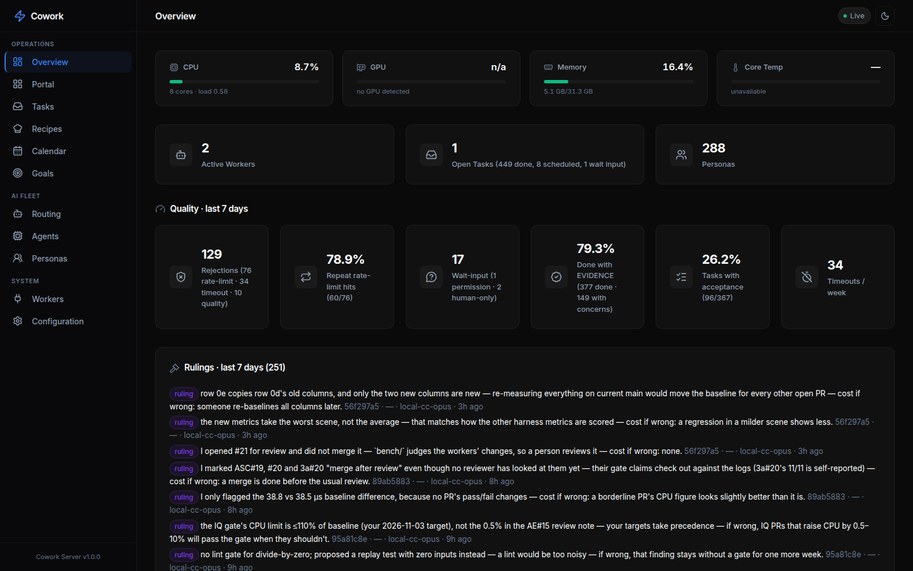
</a>

<br/><br/>

**[⚡ Quick Start](#quick-start)** •
**[💡 Why Cowork?](#-why-cowork)** •
**[⚔️ Competitive Comparison](#️-how-cowork-compares)** •
**[📖 Documentation](docs/)** •
**[🌐 Live Architecture](#task-execution--the-dispatcher)** •
**[🤝 Join as a Remote Agent](JOIN-AS-AN-AGENT.md)** •
**[⭐ Star on GitHub](https://github.com/slashman413/cowork/stargazers)**

</div>

---

### 💡 Why Cowork?

You are using **Claude Code** for development. Two hours into a sprint, you hit the dreaded rate limit:
> `Error: You have exceeded your current quota. Please wait 4 hours and 12 minutes.`

Your workflow stalls. Your terminal hangs. You switch to Gemini CLI or a local Hermes instance, but you lose your entire task state, intermediate patches, and execution context.

**Cowork solves this in one command.** It is an open-source control plane that connects all your coding agents into one unified task inbox:

- 🔀 **Smart Fallback Chains:** Route tasks from Claude Code ➔ Hermes ➔ Gemini ➔ Ollama. When an API limits out, Cowork transparently hands the work to the next agent in line.
- 🖥️ **Single-Pane-of-Glass Dark Dashboard:** Live CPU/GPU/memory thermals, running agent status, interactive calendar routines, and direct artifact downloads.
- 📁 **Zero-Database Simplicity:** Pure JSON and Markdown on disk. No Postgres, Redis, or SQLite migrations to maintain.
- ⚡ **One-Command Remote Workers:** Harness GPUs or models across laptops, Mac Studios, and cloud boxes:
  `COWORK_URL=https://hub:6868 HOST=mac-studio node cowork/deploy/remote-agent-client.mjs`
- 🎭 **285+ Built-in Specialist Personas:** Out-of-the-box routing across 19 departments (Frontend, SRE, Security, Penetration Testing, Data Engineering).

---

## ⚔️ How Cowork Compares

| Feature | **Cowork** | CrewAI / AutoGPT | OpenHands | LangGraph |
|---|:---:|:---:|:---:|:---:|
| **Primary Focus** | **Multi-CLI / Multi-Agent Control Plane** | LLM Python Scripts | Headless Dev Container | Graph Logic Framework |
| **Supports Claude Code & Hermes Native CLIs** | ✅ **Native** | ❌ No | ❌ No | ❌ No |
| **Auto Quota / Rate-Limit Fallback Chains** | ✅ **Built-in** | ❌ Manual | ❌ No | ⚠️ Custom Code |
| **Self-Hosted Dark Web UI & Hardware Telemetry** | ✅ **Instant** | ⚠️ Basic | ✅ Web UI | ⚠️ LangSmith (SaaS) |
| **Model Context Protocol (MCP) Streamable Server**| ✅ **First-class** | ❌ No | ⚠️ Partial | ❌ Custom |
| **Storage Engine** | **Plain Files / JSON** | SQLite/Postgres | Docker Volume | Postgres/Memory |
| **Multi-Machine Remote Cluster Joining** | ✅ **1-Line Node CLI** | ❌ Complex | ❌ Docker swarm | ❌ Complex |
| **Pre-loaded Agent Personas** | **285+ Personas** | 0 (DIY) | 0 (Generalist) | 0 (DIY) |

---

Jump to: [Quick Start](#quick-start) · [Connecting agents](#connecting-ai-agents) ·
[Dispatcher](#task-execution--the-dispatcher) · [Agents](#agents--named-execution-identities-model--platform--location) ·
[Vocabulary](#vocabulary) · [Thinking level](#thinking-level) ·
[MCP tools](#mcp-tools-reference)

## Screenshots

One dark-themed **single pane of glass** for the whole operation. The **Overview** shows live
host metrics (CPU / GPU / memory / temp), active workers, open tasks and personas, a
7-day quality panel (pass rate, retries, wait-input, timeouts), the latest agent
**rulings**, the dispatcher's role → model chains, and a real-time activity feed.


The sidebar groups every view: **Operations** (Overview, Portal, Tasks, Recipes, Calendar,
Goals), **AI Fleet** (Routing, Agents) and **System** (Workers, Configuration). Integrations
(skills, MCP servers and persona packs) have their own page, `/integrations.html`.
The [Tasks](#task-execution--the-dispatcher), [Routing](#agent-fallback-chains-get-apichains),
[Agents](#agents--named-execution-identities-model--platform--location) and
[Workers](#wiring-a-remote-agent-machine) views are shown in context throughout this README.

| **Calendar** — scheduled tasks and recurring routines by week | **Goals** — long-running goals with phases, decisions and budget |
|---|---|
| 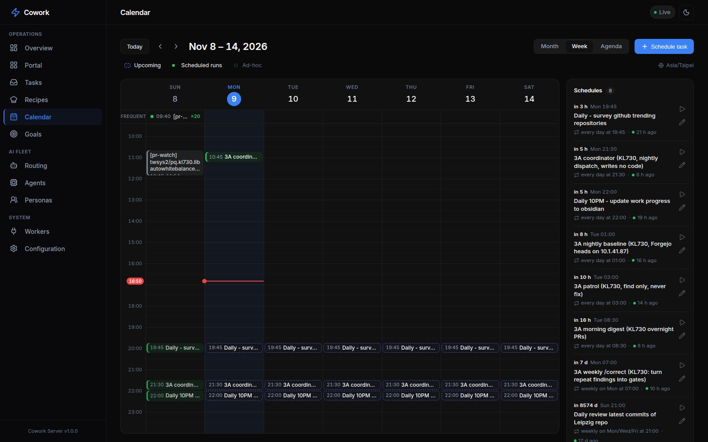 | 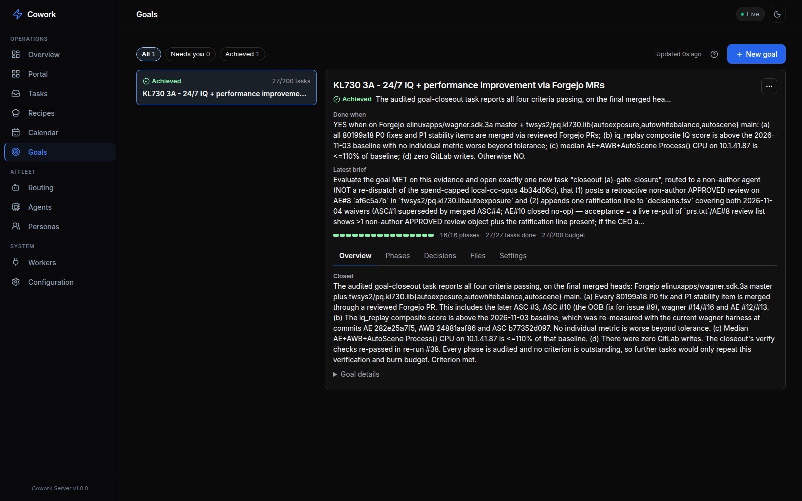 |
| **Recipes** — saved tasks you re-run with one click | **Integrations** — audited git repos installed as skills / MCP / persona packs / portal cards |
| 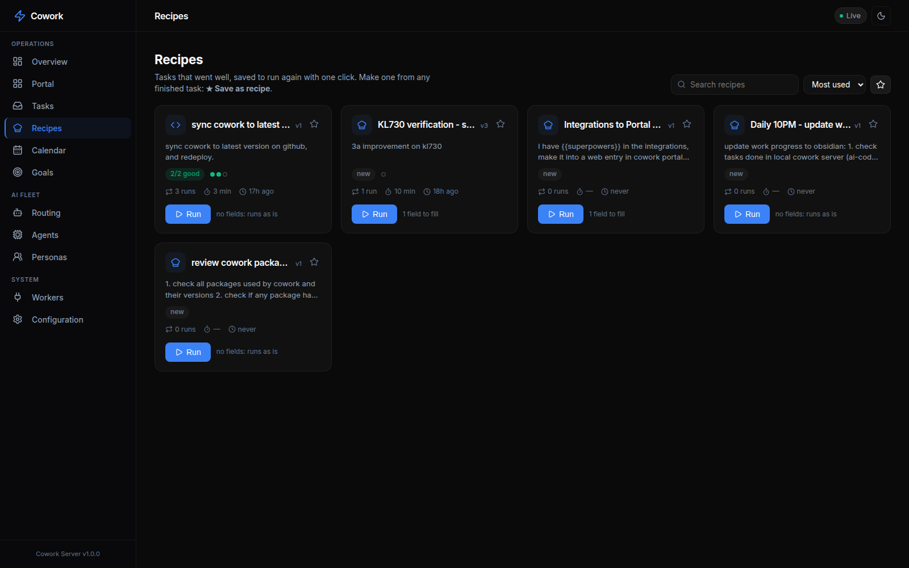 | 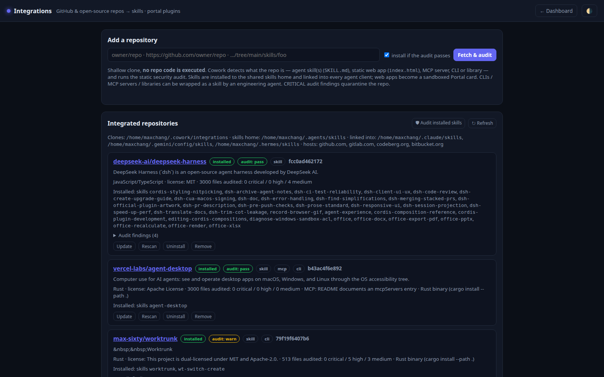 |
| **Portal** — one-click launcher for local web services | **Obsidian Vault** — the shared, readable knowledge base |
| 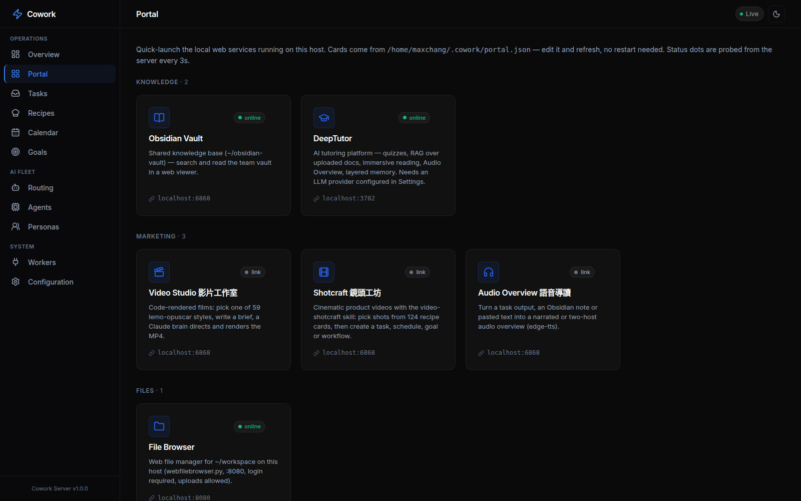 | 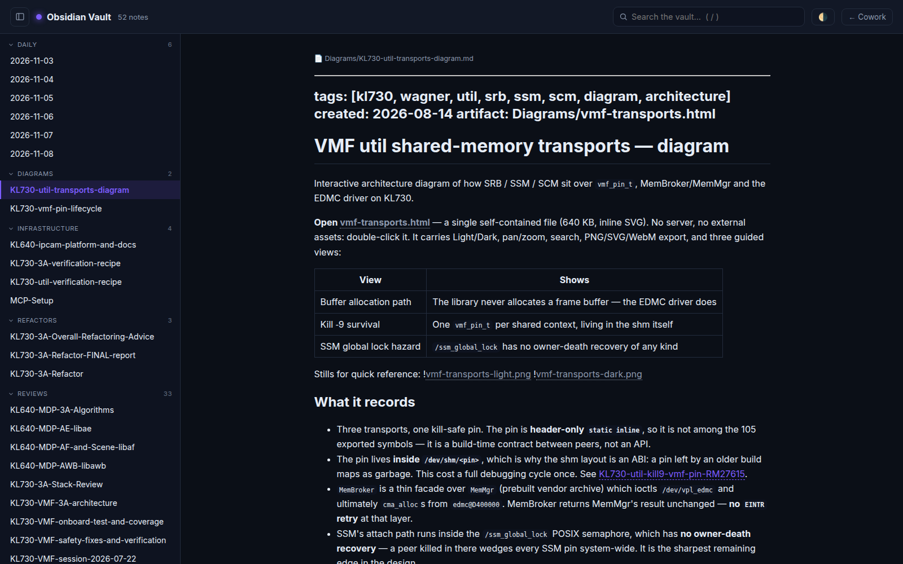 |
| **Configuration** — every setting, editable live | |
| 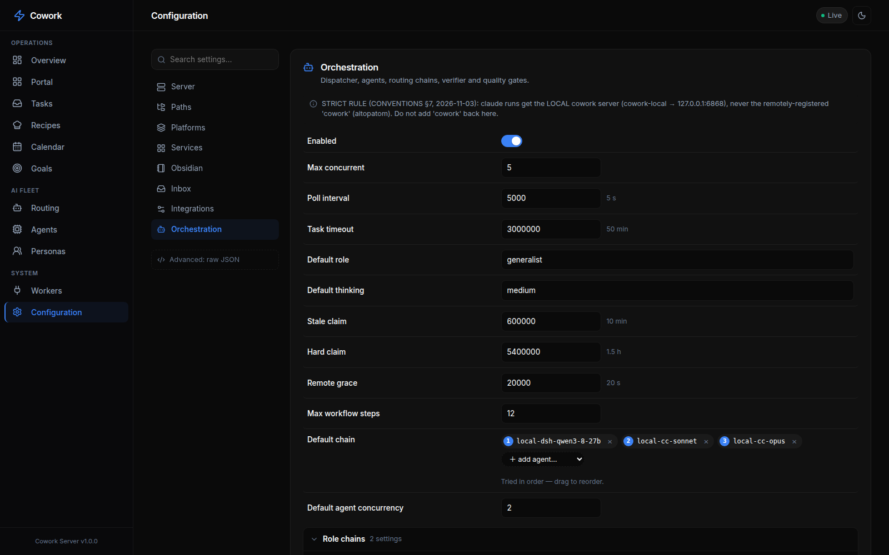 | |

## Supported Platforms

| Platform | Agents | Format |
|----------|--------|--------|
| Claude Code | ~285 | `.md` with YAML frontmatter |
| Antigravity (AGY) | Built-in + skills | `SKILL.md` |
| Hermes Agent | 39 skills | `SKILL.md` + triggers |
| Gemini CLI | Converted from source | `.md` subagents |
| Copilot | Same as Claude | `.md` agents |
| Codex | Converted | `.toml` agents |
| Cursor | Converted | `.mdc` rules |
| + 7 more | See the agency-agents persona pack | Various formats |

---

## Quick Start

### Prerequisites

- **Node.js** ≥ 20 (tested with v22)
- **npm** ≥ 10
- Nothing else to clone. Personas and skills are **integrations**: on first run, once
  the server is up, it provisions the default integrations in the background —
  `msitarzewski/agency-agents` (persona pack the router picks from per task),
  `garrytan/gbrain`, `addyosmani/agent-skills`, `anthropics/skills`,
  `vercel-labs/agent-browser`, `backnotprop/pstack`, `pbakaus/impeccable`,
  `Nutlope/hallmark`, `multica-ai/andrej-karpathy-skills`. Check them with
  `GET /api/integrations/defaults` (or the Integrations page); override the list with
  `integrations.defaults` in config.

### Fast path — two scripts (recommended)

From the repo root of your clone:

```bash
# 1. Build + launch the server (installs deps, builds, starts a systemd user service)
deploy/install-server.sh

# 2. Drop the coordination skill + MCP connection into your agent clients on this box
deploy/install-skill.sh            # auto-detects Claude Code / Hermes / Antigravity
```

`install-server.sh` generates a systemd unit with **this machine's** real node path and
working dir (nothing to hand-edit), or pass `--foreground` to launch in the terminal and
`--build-only` to stop after building. `install-skill.sh` copies the right per-client
skill into place and, for Claude Code, merges `mcpServers.cowork` into `~/.claude.json`
non-destructively (add `--url http://<host>:6868` for a remote server; `--client claude|hermes|agy|all`
to target one). The numbered steps below are the same thing, broken out for when you want
to do it by hand.

### Container (hub only)

```bash
docker run -d -p 6868:6868 -v cowork-data:/data ghcr.io/cowork/cowork:1.0.1
docker logs <container>   # first start prints the generated API key once
```

The image (amd64 + arm64) runs the MCP server, dashboard and task inbox with the local
dispatcher off: agents connect to `http://<host>:6868/mcp`, and machines offer their agents
with `deploy/remote-agent-client.mjs` (see [JOIN-AS-AN-AGENT.md](JOIN-AS-AN-AGENT.md)). Config
and all state live in the `/data` volume. `/api` and `/mcp` always require a key: pass your own
with `-e COWORK_API_KEY=…`, or the server generates one on first start, saves it to
`/data/api-key` and prints it once. Clients send `Authorization: Bearer <key>` (the agent client
reads `COWORK_API_KEY`); open `http://<host>:6868/?apiKey=<key>` once to log the dashboard in. Images are
built from `v*` tags by the release workflow on a digest-pinned base.

Once the hub is up, open **Integrations** (or `GET /api/integrations/defaults`) to check that the
default persona and skill packs finished provisioning. Until the persona pack is installed, the
router has no personas to pick from.

### 1. Install Dependencies

```bash
cd cowork/server
npm install
```

### 2. Configure Settings

**Config lives outside the repo.** The tracked `cowork/config.json` is a sanitized
**template only**. On first run the server copies it to **`~/.cowork/config.json`** —
your real per-server config (host binding, registered agents, chains). Edit *that*
copy, not the template; the server also persists all live dashboard/API edits there,
so your personal host/agent settings never touch the repo. Override the location with
the `COWORK_CONFIG` env var.

Edit `~/.cowork/config.json` to match your environment:

```json
{
  "server": {
    "port": 6868,          // ← Change the port here
    "host": "0.0.0.0",     // ← Bind address (0.0.0.0 = all interfaces)
    "name": "cowork-mcp",
    "version": "1.0.0",
    "apiKey": null          // ← Set a string to require API key auth (see below for null)
  },
  "paths": {
    "inbox": "./inbox",
    "status": "./.status",
    "decisions": "./decisions",
    "artifacts": "./artifacts",
    "inputs": "./inputs"
  }
}
```

> **All paths are relative to `cowork/`** (the parent of `server/`).
> Use `~` for home directory paths (e.g., `~/.claude/agents`).

#### Key Settings

| Setting | Default | Description |
|---------|---------|-------------|
| `server.port` | `6868` | HTTP port for MCP endpoint + Web UI |
| `server.host` | `0.0.0.0` | Bind address (`127.0.0.1` for local-only) |
| `server.apiKey` | `null` | API key for /api and /mcp. When null and `host` is not loopback, a key is generated into `api-key` beside the config and printed once |
| `server.allowUnauthenticated` | `false` | Serve a non-loopback host with no key (also `COWORK_ALLOW_NO_AUTH=1`). Only for a trusted, firewalled network |
| `server.blockedClients` | — | Client denylist enforced regardless of the API key: `{ips: [...], names: [...]}`. A matching source IP gets 403 on every path; a `names` substring (case-insensitive) in the User-Agent / `X-Cowork-Client` header, MCP `clientInfo.name`, or tool-call identity args (`agent_name`, `agent_id`, `capabilities`, `agents[].id`) gets 403 on `/api`/`/mcp`. Matching agents are disabled so tasks stop routing to them. See `server/src/core/client-guard.ts` |
| `paths.agencyAgents` | unset | Optional. Pins the roster to one local persona checkout; when unset, personas come from every installed persona-pack integration |
| `integrations.defaults` | built-in list | Repos provisioned once on first start (persona pack + skill packs) |

| `platforms.*.enabled` | `true` | Enable/disable individual platforms |
| `platforms.*.agentsDir` | varies | Where platform-specific agents live on disk |
| `services.*.enabled` | `false` | Enable/disable service health monitoring |

### 3. Start the Server

```bash
# Development mode (with hot-reload)
cd cowork/server
npm run dev

# Production mode
npm run build
npm start
```

You should see:

```
=========================================
 Multi-Agent Cowork MCP Server Started
 HTTP API: http://0.0.0.0:6868/api
 MCP Endpoint: http://0.0.0.0:6868/mcp
 SSE Stream: http://0.0.0.0:6868/api/events
=========================================
```

### 4. Open the Dashboard

Open **http://localhost:6868** in your browser.

---

## Connecting AI Agents

For programmatic access, wire the MCP connection into your agent clients:

**Scripted (recommended):** `deploy/install-skill.sh` installs the `cowork` coordination
skill and wires the MCP connection for every agent client detected on the box — one command
instead of hand-editing each config:

```bash
deploy/install-skill.sh                          # auto-detect all clients, localhost server
deploy/install-skill.sh --client claude          # just Claude Code
deploy/install-skill.sh --client all --url http://cowork-host:6868   # remote server, every client
```

It drops the per-client skill (canonical copies in `deploy/skills/`) into the client's live
skill dir and, for Claude Code, merges the `mcpServers.cowork` entry into `~/.claude.json`
without disturbing your other servers. The manual per-client config is below for reference.

### Claude Code

Add to your MCP configuration (`~/.claude.json` or project-level):

```json
{
  "mcpServers": {
    "cowork": {
      "url": "http://localhost:6868/mcp",
      "transport": "streamable-http"
    }
  }
}
```

Then in Claude Code, the agent can call:
```
Use the cowork MCP tools: register_agent, create_task, get_roster, etc.
```

### Antigravity (AGY)

Add to your AGY MCP settings:

```json
{
  "mcpServers": {
    "cowork": {
      "url": "http://localhost:6868/mcp"
    }
  }
}
```

**agy quota meter / token refresh.** To mint Antigravity access tokens, the usage
probe and `deploy/remote-agent-client.mjs` need Google OAuth client values. These are
the public values that ship with the agy and Gemini CLIs. They are not committed. Copy
[`.env.example`](.env.example) to `~/.cowork/oauth-clients.env`, fill it in, and run
`chmod 600`. Alternatively, export the same variables in the service environment;
process env takes precedence. If no values are set, the agy meter only works while a
cached CLI access token is still valid.

### Hermes Agent

Configure the MCP endpoint in Hermes:

```json
{
  "mcp_endpoints": {
    "cowork": "http://localhost:6868/mcp"
  }
}
```

### Any MCP-Compatible Client

The server speaks standard MCP over Streamable HTTP. Any client that supports
MCP can connect to `http://localhost:6868/mcp`.

---

## Task Execution — the Dispatcher

The server includes a **dispatcher** that turns queued tasks into real agent runs.
Output becomes the task `result`; the full transcript is saved as `result.md` in the
task's artifacts dir.

Every task lands in the **Task Inbox**, tagged with the division/agent that ran it and the
agent it ran on, with its output artifacts attached and filterable by status
(done · in-progress · pending · wait-input · failed).

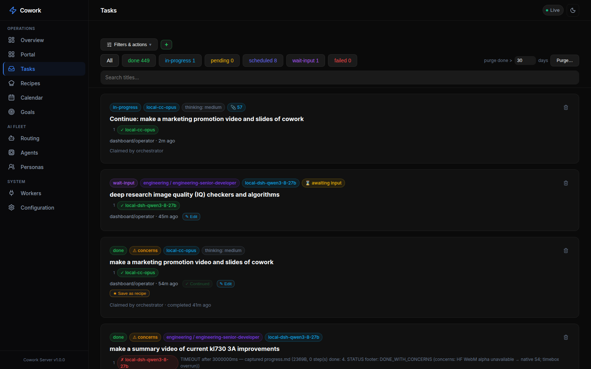

### Two-stage routing

An unassigned task is routed in **two stages** by an orchestrator/classifier agent
(default `qwen3.8-27b` via Hermes, `orchestration.classifier`):

1. **Division** — pick 1 of 19 divisions (testing, engineering, security, …). With
   `orchestration.workRoles.enabled` the same reply also names a **work role**
   (`mechanical`, `feature`, `bug-fix`, `perf-issue`, `research`, `prose`, `hardest`),
   which sets the task's `context.tier` and `context.thinking` unless the task set them
   (thinking is capped by `workRoles.budget`: small = medium, medium = high,
   large = xhigh, unlimited = max).
2. **Persona** — pick 1 of ~285 personas in that division. The chosen persona's
   `.md` file becomes the system prompt. If the router names no persona (empty reply,
   classifier off), a keyword matcher (`core/persona-match.ts`) picks one; if the reply
   can't be parsed at all, the task goes to `classifier.fallbackRole` (`generalist`).

A persona shapes the **prompt** only; the agent that runs it comes from the fallback
chain (below). Skip the router by targeting directly: `context.persona: "<persona-slug>"`
or a special-executor name. Tag a task `manual` to never auto-execute.

A task **pinned** to an agent (`context.agent`) skips agent selection. If that agent runs a
small model (≤ 70B parameters, parsed from the model id, e.g. `qwen3.8-27b`) and the task
has no persona, the router still runs first so the pinned agent gets a persona. Override
per agent with `orchestration.agents.<id>.personaRouting: "always" | "never"`.

### Executors: special roles + personas

- **Special executors** (`config.json → orchestration.roleChains`) — only
  `orchestrator`, `generalist`, `video`; each is `{description, agents: [...]}`
  with its own chain. `video` runs the ComfyUI **LTX** pipeline
  (`deploy/video-pipeline.sh`; LTX only — never Wan/Hunyuan/SVD).
- **Personas** — the ~285 personas from the installed persona-pack integrations
  (default: `msitarzewski/agency-agents`, cloned under `~/.cowork/integrations/`),
  grouped into 19 divisions. They have no chain of their own: per-division and
  per-persona chains were removed on 2026-11-13, and `divisionChains` /
  `personaChains` in an old config are ignored.

### Agent fallback chains (`GET /api/chains`)

- **Global default** — `orchestration.defaultChain`; drag-reorder in the **Routing**
  view (`PUT /api/chains/default`).
- **Tier lists** — `orchestration.tiers.<mechanical|standard|judgment>`
  (`GET /api/chains/tiers`, `PUT /api/chains/tier/:tier`). A task with a `context.tier`
  (set by hand or by its work role) tries its tier's agents first, then the default chain.
- **Special executors** — `orchestration.roleChains.<role>.agents`
  (`/api/roles-config/:name`).

A chain runs top → bottom: the task runs on `chain[0]`; on failure the dispatcher
**hands over** to `chain[1]`, then `[2]`… recording the failed agent on the task
each attempt, until success or the chain is exhausted. Pin a single task to one
agent with `context.agent: "<id>"`.

The **Routing** view edits the special-executor chains, the tier lists and the default
chain: drag to reorder or `＋ add agent…`. Changes apply live, with no restart.

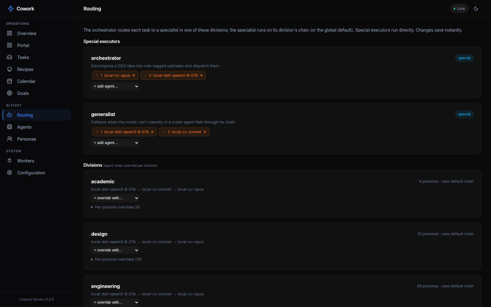

## Vocabulary

| Term | Meaning | Where you see it |
|------|---------|------------------|
| **Agent** | One model on one CLI on one machine: the thing that runs a task. Example: `local-cc-opus-5-5`. | `orchestration.agents`, `context.agent`, `/api/agents`, Agents page |
| **Thinking** | How hard an agent reasons on a run. A parameter of the run, never part of an agent id. | `context.thinking`, `agents.<id>.thinking`, `orchestration.defaultThinking` |
| **Persona** | A roster specialist the run takes on. It shapes the prompt, not the agent choice. Example: `engineering-sre`. | `context.persona`, `get_roster`, persona-pack integrations |
| **Work role** | The kind of work the router judged a task to be; sets its tier + thinking. Example: `bug-fix`. | `orchestration.workRoles`, `context.tier` |
| **Role** | A named chain of agents for a built-in job (`orchestrator`, `generalist`, `video`). | `orchestration.roleChains`, Routing page |
| **Worker** | A connected client that registers agents and claims their tasks. | `/api/workers`, Workers page, `register_agent` |

`register_agent`, `deregister_agent` and their `agent_id` / `agent_name` arguments keep their names so
connected clients don't break: `agent_id` is the **worker's** registration id, not an id from `agents`.

## Thinking level

Agent ids no longer carry a level: `local-agy-gemini-3.8-flash` replaces the `-high`, `-medium` and `-low`
variants. A run's level comes from the first of these that is set:

1. the task's `context.thinking`
2. the agent's `thinking`
3. `orchestration.defaultThinking`
4. `medium`

Levels are `low`, `medium`, `high`, `xhigh` and `max`. Set one on the New task, Edit, Re-run, Reassign and
Continue dialogs, per agent on the Agents page, or through the API:

```bash
curl -X POST "$COWORK/api/inbox" -H 'Content-Type: application/json' -d '{
  "title": "...", "description": "...", "from": {"platform": "cli", "agent": "me"}, "to": {},
  "context": {"agent": "local-cc-opus-5-5", "thinking": "high"}
}'
curl -X PATCH "$COWORK/api/agents/local-cc-opus-5-5/thinking" -H 'Content-Type: application/json' -d '{"thinking": "high"}'
```

| exec | How the level is applied |
|------|--------------------------|
| claude | `--effort <level>` |
| codex | `-c model_reasoning_effort="<level>"` (`max` runs as `xhigh`) |
| agy | model slug `<model>-<level>` (`xhigh` and `max` run as `high`; `gpt-oss-120b` only has `medium`) |
| hermes | `--reasoning <level>`, only when a level was set explicitly (`xhigh` and `max` run as `high`) |
| dsh, ollama, script | no reasoning control, so the level is ignored |

### Upgrading from the old naming

A hub upgraded from the `brain` naming migrates itself: on start, the server detects the old config shape, backs up
the config and state to `backups/agent-naming-boot-*.tar.gz` next to the config, and runs
`scripts/migrate-agent-naming.mjs` before loading anything. So `git pull && deploy/redeploy.sh` is enough. Local
clients still on `cowork-local-brain@` keep working under that unit; `deploy/cutover-agent-naming.sh` moves them to
`cowork-local-agent@`.

Clients on the old contract keep working: the hub translates their old field names at the door
(`server/legacy-aliases.json`, read only by `server/src/legacy-wire.ts`) and answers with `agent_aliases` so they
can update. `GET /api/legacy-wire` counts how often that still happens. Once it stays at zero, delete those two files.

## Agents — named execution identities (model × platform × location)

`config.json → orchestration.agents` (`GET /api/agents`) names each agent a chain
can reference. The **Agents** view lists every registered agent — its platform
(`claude` / `agy` / `hermes`), underlying model, location, and whether it was
`auto`-registered by a connecting client — with one-click deregister:

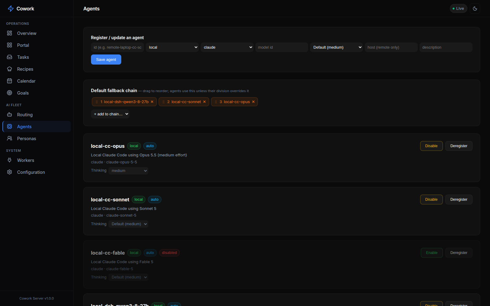

| Alias | Location | Runs |
|-------|----------|------|
| `local-hermes-qwen3.8-27b` | local | Hermes on that model |
| `local-dsh-qwen3-8-27b` | local | DeepSeek Harness (`dsh`) on that model |
| `local-cc-opus-5-5` / `-sonnet-5-5` / `-fable-5-1` | local | Claude Code on that model |
| `local-agy-*` / `local-comfy-ltx` | local | Antigravity/Gemini / ComfyUI-LTX video |
| `local-codex-gpt-6-luna` / `-gpt-5-6-terra` / `-gpt-5-6-luna` / `-default` | remote | Codex on this host, claimed by the codex client |
| `local-script-eval-harness` | local | The `eval-prompt-change` harness (`exec: script`) |
| `remote-ai-code-gen-cc-*` | remote | Claude Code on the ai-code-gen machine |
| `remote-<host>-cc-sonnet-5-5` | remote | Claude Code on another machine |

This table is an example. Read the live set with `GET /api/agents`.


Agent ids carry the **model version** (`local-cc-opus-5-5`, not `local-cc-opus`) so the
model an agent runs is readable from its id; only `-default` agents, which follow the
account default, are unversioned.

**Naming convention — the prefix names the machine, `location` names the runner.**
The `local-`/`remote-` id prefix says **which machine the agent executes on**:
`local-` = this host (it can see `/home/wayne`, `~/.priv`, the GPU), `remote-` =
another machine (`remote-<host>-…`). The separate `location` field says **who
starts it**: `local` = the dispatcher spawns it, `remote` = a client claims it from
the inbox. The two usually agree, but not always — `local-codex-*` runs on this
host yet has `location: remote` because the codex client claims its tasks. Code must
read `location`, never infer it from the prefix. DeepSeek
agents are retired — any id matching `/deepseek/i` is scrubbed from the registry on
load (see `DENYLISTED_AGENT_RE`), so never put `deepseek` in a new id.

**Renamed ids keep working.** `AGENT_ID_ALIASES` in `server/src/config.ts` (plus an
optional `orchestration.agentAliases` in config) maps retired ids to their canonical
id. Old ids in an on-disk config, a task's `context.agent` pin, or a client's
registration all resolve to the canonical agent. A client that still declares an
old id keeps receiving its tasks under that id (`clientId` on the agent), until it
re-declares the canonical one. Renames (2026-10-07, and codex again on 2026-11-03):

| Retired id | Canonical id |
|------------|--------------|
| `local-ha-qwen3-8-27b`, `local-ha-qwen38-27b`, `local-ha-qwen3.8-27b` | `local-hermes-qwen3.8-27b` |
| `remote-codex-default` / `-gpt-5-6-terra` / `-gpt-5-6-luna` / `-gpt-6-luna` | `local-codex-default` / `-gpt-5-6-terra` / `-gpt-5-6-luna` / `-gpt-6-luna` (2026-11-03: the prefix names the machine, so the 10-07 `local-codex-*` → `remote-codex-*` rename was reversed) |
| `remote-ai-code-gen-cc-opus` / `-sonnet` / `-fable` | `remote-ai-code-gen-cc-opus-4-8` / `-sonnet-5` / `-fable-5` |

**Local** agents the dispatcher spawns here. **Remote** agents it leaves `pending`
and **publishes the agent id onto the task's `context.agent`** so that machine's
client can discover and claim it (the client filters `list_inbox` for tasks whose
`context.agent` is one of its own ids). If no client claims a remote rung within
`orchestration.remoteGraceMs` (default 60 s), the dispatcher advances to the next
agent in the chain, so a clientless remote rung never stalls a task.

**Artifacts** work for both: local agents save files to `$COWORK_ARTIFACTS_DIR`
(the dispatcher collects them from disk); remote agents save to the same env dir
and the client **uploads** each file via `POST /api/artifacts/:taskId/:file`.
Either way they land in `artifacts/<task-id>/` and become downloadable from the
Inbox. **Outputs** (the task's final deliverables) go in the `outputs/` subfolder
(`$COWORK_OUTPUTS_DIR`; remote clients upload via `POST /api/outputs/:taskId/:file`)
and get their own OUTPUTS section on the card, after RESULT and before ARTIFACTS.

**Input files** flow the other way — a person attaches files for the agent to
**read**. Attach them on any Inbox card ("＋ Attach
files"); they are stored under `inputs/<task-id>/` and mirrored onto
`context.inputFiles`. The dispatcher points a **local** agent at their absolute
paths in the prompt; a **remote** agent client downloads them (`GET /api/inputs/:taskId`)
before running and lists their local paths in the prompt. Inputs survive a re-run.

**Failed tasks & re-run.** When a task exhausts its whole fallback chain (every
agent failed verification) it finishes flagged `failed: true`. The Inbox groups
these under a red **"failed"** filter (kept out of the green "done" count) and
offers a confirm-gated **↻ Re-run** that resets the task to `pending` from the top
of its chain (`POST /api/inbox/:id/rerun`) — preserving its brief and attached inputs.

### Auto-registered agents (clients-capability protocol)

A connecting MCP client DECLARES the agents it can run via the `register_agent`
tool's `agents` field; the server auto-adds them to the registry (marked `dynamic`,
owned by that client). One machine can offer several models at once. Auto-registered
agents persist and are removed **only** by `deregister_agent` or the Agents view
(never on heartbeat timeout); removal cascades out of the default chain, every
tier list, and every special role. Manage all of this from the dashboard's
**Agents** and **Routing** views.

### Wiring a remote agent machine

`deploy/remote-agent-client.mjs` is a zero-dependency (Node 18+) Cowork **MCP**
client that does exactly that loop. Its header comment documents every env var.

**Quickest — run it directly** (foreground; good for a first test). One agent:

```bash
git clone <cowork-repo-url> cowork   # the git remote your hub was installed from
COWORK_URL=http://<cowork-host>:6868 EXEC=claude MODEL=claude-sonnet-5-5 \
  AGENT_ID=remote-<host>-cc-sonnet-5-5 \
  node cowork/deploy/remote-agent-client.mjs
```

Several agents from one machine (declares them all; each becomes a targetable agent):

```bash
COWORK_URL=http://<cowork-host>:6868 EXEC=claude HOST=<host> \
  AGENTS='[{"id":"remote-<host>-cc-opus-5-5","model":"claude-opus-5-5"},
           {"id":"remote-<host>-cc-sonnet-5-5","model":"claude-sonnet-5-5"}]' \
  node cowork/deploy/remote-agent-client.mjs
```

**As a boot service** (recommended for permanent machines):

```bash
mkdir -p ~/.config/cowork-remote-agent
cp cowork/deploy/remote-agent-client.env.example ~/.config/cowork-remote-agent/aicodegen.env
# edit: COWORK_URL, AGENTS (or AGENT_ID), EXEC, HOST, COWORK_CLIENT_JS
cp cowork/deploy/cowork-remote-agent@.service ~/.config/systemd/user/
systemctl --user daemon-reload && systemctl --user enable --now cowork-remote-agent@aicodegen
```

It connects to `COWORK_URL/mcp`, `register_agent`s (declaring its `AGENTS`, which
auto-register into the registry), then polls and claims only tasks whose
`context.agent` is one of its agent ids, runs the matching `EXEC`/`MODEL`, and
`complete_task`s with its result and uploaded artifacts — appearing in **Workers** like any other
client. **Flexible**: the same script serves any agent by changing env only.
**Scalable**: add machines/agents by adding `<name>.env` files; claims are atomic
(single-process compare-and-set) so even multiple clients on the *same* agent id
never double-run a task — first claim wins.

Every connected client shows up live in the **Workers** view — grouped by platform,
listing the agents it offers, its idle/busy state, and a per-session tally of how many
tasks each agent has run vs. submitted:

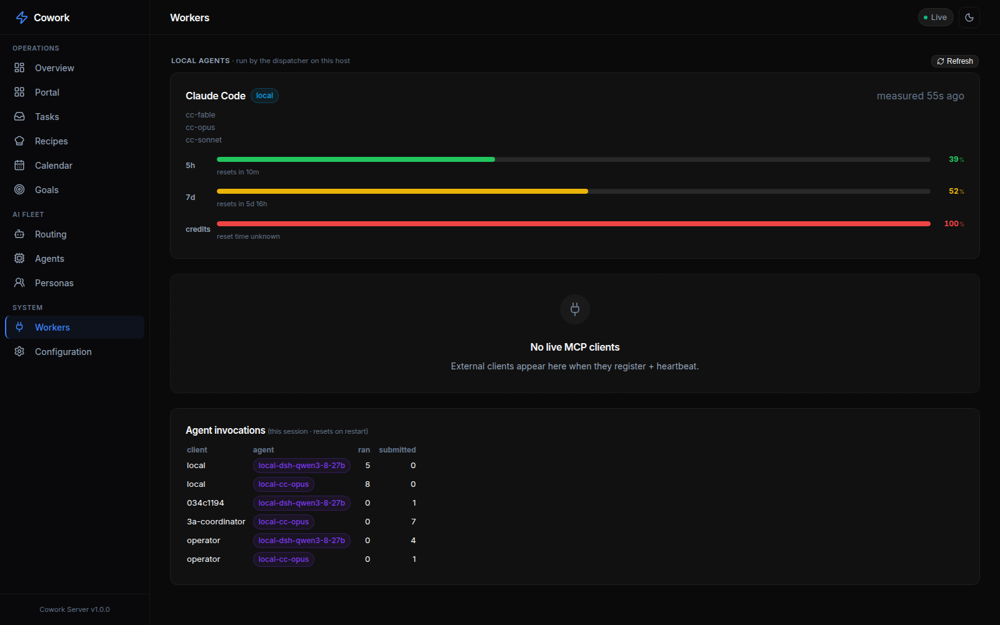

The always-on coordinator agent shown in **Workers** as `cowork/orchestrator`
polls the inbox, two-stage-routes unassigned tasks, reclaims orphans, and
dispatches; transient per-task workers appear as e.g.
`testing / Workflow Optimizer · local-hermes-qwen3.8-27b` or `video · local-comfy-ltx`
while running.

CEO flow: tell Hermes (e.g. via Discord) an idea → Hermes creates ONE task with
`context.persona: "orchestrator"` → the orchestrator decomposes it into subtasks via
`POST /api/inbox` → each subtask is two-stage-routed (persona + work role) and runs on
its tier/default chain → results and artifacts appear live on the dashboard.

### LLM classifier — no task left behind

An unassigned task (e.g. a free-text idea filed straight from Discord) no longer
stalls: the dispatcher runs the **two-stage LLM router** (default qwen3.8-27b
via Hermes, `orchestration.classifier` in config.json) that reads the task, picks
a division (plus a work role), then a persona, and the task dispatches normally on
its tier/default chain. Tag a task `manual` to skip both routing and dispatch.


### Stale-claim reclaim

`orchestration.staleClaimMs` (code default `0` = off; the template `config.json` sets 10 min) reclaims any in-progress task
whose claiming agent has disappeared — a crashed/exited live agent or a
dispatcher killed mid-run — back to `pending` so the work is retried. A task
still owned by a heartbeating agent is never touched.

Dispatcher status: `GET /api/dispatcher`. Tune `orchestration.maxConcurrent` /
`taskTimeoutMs` / `pollIntervalMs` / `classifier` / `staleClaimMs` in config.

## Deployment (systemd) & Remote Access

Easiest — `deploy/install-server.sh` generates and enables the user service with this
machine's resolved node path and working dir:

```bash
deploy/install-server.sh          # build + install & start the cowork-mcp user service
```

Manual equivalent (the tracked `deploy/cowork-mcp.service` has `/home/USER` placeholders
you must edit first — the script fills them in for you):

```bash
cp deploy/cowork-mcp.service ~/.config/systemd/user/   # then edit the USER/paths inside
systemctl --user daemon-reload
systemctl --user enable --now cowork-mcp
```

With `server.host: "0.0.0.0"` the dashboard is reachable from other machines at
`http://<host-ip>:6868/` (LAN or Tailscale IP — `0.0.0.0` itself is a bind
address, not a URL). A non-loopback host always requires a key: set `server.apiKey`
(or `COWORK_API_KEY`), or use the one generated into `api-key` beside the config on first
start. Log the dashboard in once with `http://<host-ip>:6868/?apiKey=<key>` (it sets a
same-site cookie). `server.allowUnauthenticated: true` opts out; anyone who can reach the port
can then create tasks for your agents.

**Moving a running open hub to a key without locking anyone out:** set the key *and* keep
`allowUnauthenticated: true`. That is soft (migration) mode: a valid key is accepted, a wrong key
gets 401, and keyless requests still pass but are listed at `GET /api/auth/keyless` (key required).
Give the key to every client (agent clients: `COWORK_API_KEY`; MCP configs: an
`Authorization: Bearer <key>` header, e.g. `deploy/install-skill.sh --key <key>`; dashboards:
`/?apiKey=<key>` once). Dispatched tasks get `COWORK_API_KEY` in their env automatically. When
`/api/auth/keyless` stays empty, drop `allowUnauthenticated` and restart to enforce.

### Switching from HTTP to HTTPS

By default the server listens over plain `http://`. That is fine over `localhost`,
but a browser only exposes the **microphone** (the New-task *Dictate* speech-to-text
button) in a **secure context** — `https://` or `http://localhost`. Reach the
dashboard over `http://<lan-or-tailscale-ip>:6868` and `navigator.mediaDevices` is
undefined, so Dictate can't start. Serving over HTTPS fixes it.

When `server.tls` points at valid cert/key files, Cowork runs a **multiplexed dual-protocol listener**
on port 6868 that accepts both HTTP and HTTPS simultaneously:

- **Localhost in Chrome (`http://localhost:6868/`)**: Chrome and modern browsers natively treat
  `http://localhost` as a W3C-standard **Secure Context** (`window.isSecureContext === true`).
  The New-task *Dictate* mic button and clipboard work out of the box with **zero certificate warnings**.
- **Remote / Mobile on Tailscale (`https://<machine>.tailXXXX.ts.net:6868/`)**: Remote connections
  use the valid Let's Encrypt TLS certificate provisioned via Tailscale. Chrome shows a verified,
  trusted green lock.
- **Automatic IP/Domain HTTP-to-HTTPS Redirection**: Requests arriving over plain HTTP for external
  hostnames or IPs are automatically redirected (302) to the trusted HTTPS domain.
- **SNI Fallback**: Multi-domain TLS SNI callback routes domain traffic to the trusted certificate
  and loopback TLS traffic to the local fallback certificate.

Migrate in this order:

1. **Obtain or Generate a TLS Certificate:**
   - **Tailscale Let's Encrypt (Recommended, Zero Warnings)**:
     ```bash
     deploy/update-tailscale-cert.sh
     ```
     This fetches a genuine Let's Encrypt certificate via `tailscale cert` and installs it to
     `~/.cowork/tls/cert.pem` and `~/.cowork/tls/key.pem`.
   - **Self-Signed (Alternative)**:
     ```bash
     server/gen-tls-cert.sh ~/.cowork/tls cowork-host 100.64.0.1 cowork.tailXXXX.ts.net
     ```

2. **Point the config at the files.** Add a `tls` block under `server` in
   `~/.cowork/config.json` (the live config — the repo `config.json` is only the
   default template and ships `"tls": null`):

   ```jsonc
   "server": {
     "host": "0.0.0.0",
     "port": 6868,
     "tls": { "certFile": "~/.cowork/tls/cert.pem", "keyFile": "~/.cowork/tls/key.pem" }
   }
   ```

   `~` and repo-relative paths are resolved for you. **This is the step most often
   missed:** generating the cert alone does nothing — without this block the server
   stays on `http://`.

3. **Restart the server so the new scheme takes effect.** A plain
   `systemctl --user restart cowork-mcp` run *from inside a task* SIGKILLs that task
   (it is a child of the unit it's restarting), so use the idle-safe redeploy, which
   waits until no task is in flight:

   ```bash
   systemd-run --user --collect --unit=cowork-server-redeploy \
     deploy/redeploy-server-when-idle.sh
   ```

   Confirm it came up:

   ```bash
   journalctl --user -u cowork-mcp -n 10 | grep -E 'Trusted HTTPS|Local HTTP|API:'
   curl -s http://localhost:6868/api/status | jq .uptime
   ```

4. **Accessing the Dashboard in Chrome:**
   - **On the host machine**: Open `http://localhost:6868/` (Secure Context active, 0 SSL warnings).
   - **From remote devices or mobile**: Open `https://<tailscale-domain>:6868/` (Trusted Let's Encrypt SSL lock).

5. **Updating Agent Clients and Skills:**
   Run `deploy/install-skill.sh`, which automatically detects your Tailscale domain or localhost
   configuration:

   ```bash
   deploy/install-skill.sh --client all
   ```

> **Server-side self-dispatch is loopback-optimized** — local subtask dispatch runs over
> `http://localhost:6868` through the multiplexed listener, avoiding TLS handshake overhead
> and certificate hostname mismatch errors entirely.

To roll back, set `server.tls` to `null` (or remove the block) and redeploy — the
server returns to `http://`.

## MCP Tools Reference

Once connected, agents have access to these tools:

| Tool | Description |
|------|-------------|
| `register_agent` | Register this client; optionally DECLARE the `agents` it can run |
| `deregister_agent` | Remove this client and cascade-remove every agent it registered |
| `heartbeat` | Update status and current task |
| `get_roster` | Search ~285 personas across 19 divisions |
| `create_task` | Create a task for another agent/platform |
| `claim_task` | Claim a pending inbox task |
| `complete_task` | Mark a task as done with results |
| `list_inbox` | List inbox tasks with status/platform filters |
| `get_dashboard` | Get full dashboard data (active workers, inbox stats, etc.) |
| `create_goal` / `list_goals` / `get_goal` / `update_goal_progress` | Long-lived, phase-tracked Goals driven toward a yes/no success criterion |
| `obsidian_info` / `obsidian_search` / `obsidian_read` / `obsidian_list` | Shared Obsidian knowledge base (when a vault is configured) |
| `integrations` | Integrate a git / open-source repository (list, add, install, …) |

### Example: Cross-Platform Task Dispatch

```
You: "Review the auth code in saas-starter"

AGY Agent calls:
  create_task(
    title: "Review auth middleware",
    from_platform: "antigravity",
    from_agent: "self",
    to_platform: "claude",
    to_agent: "engineering-code-reviewer",
    priority: "normal"
  )

→ Task appears in dashboard inbox
→ Claude Code picks it up, runs review
→ Claude calls complete_task(...) with its result + artifacts
→ Result + artifacts appear on the task card
```

---

## Recipes and Goals — repeatable and long-running work

The declarative **Workflows** engine (`workflows/*.json`, `/api/workflows*`, the
Workflows tab) was removed on 2026-11-02. Its jobs are covered by:

- **Recipes** — a task saved from a good run, or written from scratch with **New recipe**,
  with `{{fields}}` you fill in per run. A recipe carries its agent, thinking level and
  timebox; the Run sheet can override agent and thinking for one run
  (`POST /api/recipes/:id/run` with `{values, agent, thinking, scheduledAt, recurrence}`).
  Recipes don't pin a persona: the router picks one per run.
- **Goals** — a long-lived objective with a yes/no success criterion and phases, driven by
  the Achiever loop until it is met (`create_goal`, `/api/goals`). See
  [docs/goals-redesign.md](docs/goals-redesign.md) and [docs/goal-loop-idiom.md](docs/goal-loop-idiom.md).
- **Orchestrator decomposition** — a task with `context.persona: "orchestrator"` splits
  itself into subtasks through `POST /api/inbox`.

## REST API

The Web UI uses these endpoints (also available for scripts/integrations):

| Method | Path | Description |
|--------|------|-------------|
| `GET` | `/api/status` | Dashboard overview data |
| `GET` | `/api/workers` | All active workers (id → name) |
| `GET` | `/api/connections` | Live MCP clients (heartbeat) + per-agent ran/submitted counters |
| `GET` | `/api/inbox?status=pending` | Inbox tasks (filterable) |
| `GET` | `/api/tasks` | Same list and filters as `/api/inbox`, wrapped as `{tasks}` |
| `POST` | `/api/inbox` | Create a new task; optional `inputs: [{token,name}]` attaches uploaded files |
| `PATCH` | `/api/inbox/:id` | Claim or complete a task |
| `POST` | `/api/inbox/:id/rerun` | Re-queue a FAILED (chain-exhausted) task — reset to pending from the top of its chain, keep its inputs |
| `GET`/`POST` | `/api/inbox/:id/inputs` | List / attach input files to an existing task (`{inputs:[{token,name}]}`) |
| `POST` | `/api/uploads?name=<file>` | Stage an uploaded file (raw body) → `{token}` to pass as a task input |
| `GET` | `/api/inputs/:taskId`, `/:taskId/:file` | List / download a task's attached input files |
| `POST` | `/api/inbox/:id/pause`, `/resume` (or `/api/tasks/pause\|resume` with `{taskId}`) | Pause a task (stops a running agent) / resume it with its context intact |
| `GET` | `/api/tasks/paused` | Paused tasks |
| `GET` | `/api/roster?division=engineering` | Personas from the installed persona packs (filterable) |
| `GET` | `/api/roster-divisions` | Personas grouped by division |
| `GET` | `/api/dispatcher` | Special roles + agents + defaultChain + running |
| `GET`/`PUT` | `/api/chains`, `/chains/default`, `/chains/tiers`, `/chains/tier/:tier` | Read/edit the default chain and tier lists |
| `GET`/`PUT`/`DELETE` | `/api/agents`, `/api/agents/:id` | Agent registry (cascades on delete) |
| `PATCH` | `/api/agents/:id/enable`, `/disable`, `/thinking` | Toggle an agent, set its default thinking level |
| `GET` / `PUT`/`DELETE` | `/api/roles-config` / `/api/roles-config/:name` | Special-executor chains |
| `GET`/`POST` | `/api/recipes`, `/api/recipes/:id` (`PUT`/`DELETE`), `/api/recipes/:id/run`, `/api/recipes/draft-from-task/:taskId` | Saved recipes |
| `GET`/`POST` | `/api/goals`, `/api/goals/:id` (`PATCH`/`DELETE`), `/goals/:id/activate\|pause\|block`, `/goals/templates` | Goals |
| `GET` | `/api/calendar` | Scheduled + recurring tasks for the Calendar view |
| `GET`/`POST` | `/api/integrations`, `/api/integrations/:id/:action`, `/api/integrations/defaults`, `/api/integrations/defaults/provision` | Integrations (skills, MCP, persona packs); verify / re-run first-run provisioning |
| `GET`/`POST` | `/api/artifacts/:taskId`, `/:taskId/:file` | List/download; POST (raw body) uploads a file from a remote agent |
| `GET`/`POST` | `/api/outputs/:taskId`, `/:taskId/:file` | Same, for the task's `outputs/` deliverables |
| `GET` | `/api/config` | Current configuration |
| `GET` | `/api/events` | SSE event stream |

---

## Directory Structure

```
cowork/
├── config.json              # TEMPLATE only — real config at ~/.cowork/config.json
├── README.md                # This file
├── PROTOCOL.md              # Protocol specification
├── JOIN-AS-AN-AGENT.md       # Onboarding for a remote agent client
├── CONVENTIONS.md           # Operating rules injected into every dispatched task
├── layout.json / portal.json # Dashboard nav + widgets / Portal cards (live copies in ~/.cowork/)
├── methods/                 # Playbook cards the sharpener attaches to a task
├── vendor/pstack/           # Vendored pstack skills
├── server/                  # MCP Server + Web UI
│   ├── src/                 # TypeScript source
│   └── public/              # Web UI (HTML/CSS/JS)
├── deploy/                  # systemd units, remote-agent client, presets, skills
├── inbox/                   # Task queue (JSON files, auto-managed)
├── artifacts/               # Per-task OUTPUT files (audio/video/md), downloadable
├── inputs/                  # Per-task INPUT files a person attached for the agent (gitignored)
├── goals/                   # Goal aggregates (runtime, gitignored)
├── decisions/               # Decision log
└── .status/                 # Runtime state (auto-managed)

~/.cowork/
├── config.json              # Real per-server config
├── integrations.json        # Integration registry
└── integrations/            # Cloned integrations, incl. the persona pack(s)
```

---

## Debugging

### MCP Inspector

Test the MCP endpoint with the official inspector:

```bash
npx @modelcontextprotocol/inspector http://localhost:6868/mcp
```

This opens a web UI at http://localhost:6274 where you can browse and test all
MCP tools interactively.

### curl Examples

```bash
# Check server status
curl http://localhost:6868/api/status | jq

# List active workers
curl http://localhost:6868/api/workers | jq

# List pending inbox tasks
curl "http://localhost:6868/api/inbox?status=pending" | jq

# Browse engineering personas
curl "http://localhost:6868/api/roster?division=engineering" | jq

# Watch real-time events
curl -N http://localhost:6868/api/events
```

### Test MCP Tool Calls

```bash
# Register a test agent
curl -X POST http://localhost:6868/mcp \
  -H "Content-Type: application/json" \
  -d '{
    "jsonrpc": "2.0",
    "method": "tools/call",
    "params": {
      "name": "register_agent",
      "arguments": {
        "platform": "antigravity",
        "agent_name": "test-agent",
        "current_task": "Testing MCP connection"
      }
    },
    "id": 1
  }'

# Get dashboard data
curl -X POST http://localhost:6868/mcp \
  -H "Content-Type: application/json" \
  -d '{
    "jsonrpc": "2.0",
    "method": "tools/call",
    "params": {
      "name": "get_dashboard",
      "arguments": {}
    },
    "id": 2
  }'
```

---

## Configuration Reference

### Full `config.json` Example

```json
{
  "server": {
    "port": 6868,
    "host": "0.0.0.0",
    "name": "cowork-mcp",
    "version": "1.0.0",
    "apiKey": null
  },
  "paths": {
    "inbox": "./inbox",
    "status": "./.status",
    "decisions": "./decisions",
    "artifacts": "./artifacts",
    "inputs": "./inputs"
  },
  "platforms": {
    "claude": {
      "enabled": true,
      "agentsDir": "~/.claude/agents",
      "color": "#D97757"
    },
    "hermes": {
      "enabled": true,
      "skillsDir": "../hermes-agent/skills",
      "color": "#7C3AED"
    },
    "antigravity": {
      "enabled": true,
      "skillsDir": "~/.gemini/config/skills",
      "color": "#0EA5E9"
    }
  },
  "inbox": {
    "autoArchiveDays": 30,
    "maxRetries": 3
  }
}
```

Portal launcher cards live in their own file, `portal.json` (live copy
`~/.cowork/portal.json`, hot-reloaded) — see [docs/dashboard.md#portal](docs/dashboard.md#portal).

### Environment-Specific Overrides

The real config is read from `~/.cowork/config.json` by default. Point at a
different file with the `COWORK_CONFIG` env var (and override the port / API key
without editing any file):

```bash
COWORK_CONFIG=~/.cowork/config.staging.json COWORK_PORT=6900 npm start
```

The persona catalog is cached in memory and rescanned at most once per `COWORK_ROSTER_TTL_MS`
(default 30000). A newly installed or updated persona pack propagates within that window with no
restart;
 set `0` to rescan on every query, or a larger value to reduce disk work.

---

### ⭐ Why Star Cowork?

GitHub stars tell us which agent integrations (Cursor MCP, Windsurf, Roo-Code, Goose) to build next.
- ⭐ **Star now** to bookmark this project and receive release alerts when new agent adapters drop.
- 🍴 **Fork** to run an isolated agent fleet for your team or homelab.

[](https://star-history.com/#slashman413/cowork&Date)

---

### Cowork Pro

[Cowork Pro ($59)](https://slashmaster6.gumroad.com/l/cowork-pro?utm_source=cowork&utm_medium=readme) is the production
package: advanced workflows, priority support and lifetime updates. It is also part of the
[AI Developer Stack Bundle ($79)](https://slashmaster6.gumroad.com/l/ai-dev-stack?utm_source=cowork&utm_medium=readme).

## License

[MIT](LICENSE) © 2026 Cowork. The core server, dashboard and remote-agent client are
free and open source; Cowork Pro (above) is the separate paid add-on.